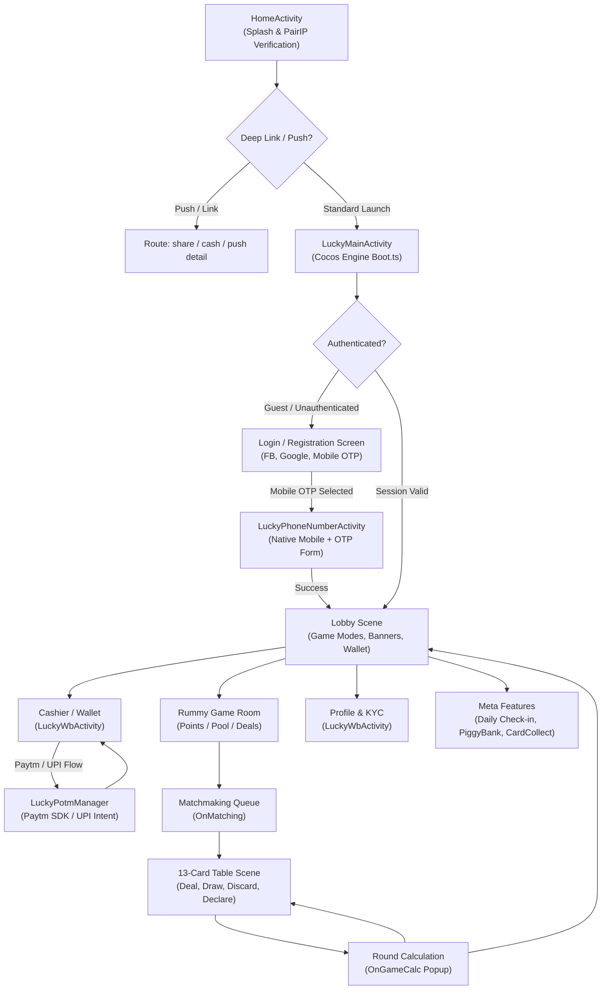

# APK Reverse Engineering & Technical Analysis

**Target Application:** Junglee Rummy - Indian Rummy (`base.apk` + split config APKs)  
**Package Name:** `com.rummygamein.gameprjrumm`  
**Version:** `1.1.5` (versionCode: `1`)  
**Target SDK:** `36` (Android 16 Preview) | **Min SDK:** `24` (Android 7.0 Nougat)  
**Analysis Engine:** Direct inspection & extraction of APK assets, bytecode, resources, and REA toolchain evaluation  
**Date:** 2026-11-24

---

## 1. Application Manifest & Architecture

### Package & SDK Evidence
- **Source:** Decoded `AndroidManifest.xml` (Binary XML string pool and chunk definitions)
- **Package Name:** `com.rummygamein.gameprjrumm`
- **Application Class:** `com.pairip.application.Application` (PairIP runtime protector/packer)
- **Original App Name / Label:** `"Junglee Rummy - Indian Rummy"` (`res/values/strings.xml` string ID `@string/app_name` `[279]`)
- **Version Code:** `1`
- **Version Name:** `1.1.5`
- **Compile SDK:** `36` (`compileSdkVersionCodename=16`)
- **Min SDK:** `24` (`minSdkVersion=24`)
- **Target SDK:** `36` (`targetSdkVersion=36`)
- **Native ABI Architectures:** `arm64-v8a` (contained in `split_config.arm64_v8a.apk`)

---

### Permissions Declared
| Permission | Classification | Evidence / Source |
|---|---|---|
| `android.permission.INTERNET` | Required (Network Communication) | `AndroidManifest.xml` |
| `android.permission.ACCESS_NETWORK_STATE` | Required (Network Connectivity Monitoring) | `AndroidManifest.xml` |
| `android.permission.ACCESS_WIFI_STATE` | Required (WiFi Connection State) | `AndroidManifest.xml` |
| `android.permission.CHANGE_NETWORK_STATE` | Optional / Diagnostic | `AndroidManifest.xml` |
| `android.permission.CHANGE_WIFI_STATE` | Optional / Diagnostic | `AndroidManifest.xml` |
| `android.permission.WAKE_LOCK` | Required (Prevent screen sleep during gameplay) | `AndroidManifest.xml` |
| `android.permission.VIBRATE` | Required (Haptic feedback on card actions) | `AndroidManifest.xml` |
| `android.permission.POST_NOTIFICATIONS` | Android 13+ Notification Prompt | `AndroidManifest.xml` |
| `android.permission.READ_EXTERNAL_STORAGE` | Storage Access | `AndroidManifest.xml` |
| `android.permission.WRITE_EXTERNAL_STORAGE` | Storage Access | `AndroidManifest.xml` |
| `com.google.android.gms.permission.AD_ID` | Advertising ID Tracking | `AndroidManifest.xml` |
| `com.android.vending.CHECK_LICENSE` | Google Play License Verification | `AndroidManifest.xml` |
| `com.google.android.finsky.permission.BIND_GET_INSTALL_REFERRER_SERVICE` | Attribution / Install Referrer | `AndroidManifest.xml` |
| `android.permission.ACCESS_ADSERVICES_AD_ID` | Android Privacy Sandbox | `AndroidManifest.xml` |
| `android.permission.ACCESS_ADSERVICES_ATTRIBUTION` | Android Privacy Sandbox | `AndroidManifest.xml` |
| `android.permission.ACCESS_ADSERVICES_CUSTOM_AUDIENCE` | Android Privacy Sandbox | `AndroidManifest.xml` |
| `android.permission.ACCESS_ADSERVICES_TOPICS` | Android Privacy Sandbox | `AndroidManifest.xml` |

---

### Manifest Components (Activities, Services, Receivers, Providers)

#### Activities
1. **`com.rummygamein.gameprjrumm.HomeActivity` (MAIN ENTRY POINT)**
   - **Type:** Launcher Activity (`android.intent.action.MAIN`, `android.intent.category.LAUNCHER`)
   - **Attributes:** `screenOrientation=1` (PORTRAIT), `launchMode=2` (singleTask), `hardwareAccelerated=false`
   - **Deep Link Filters:**
     - Custom scheme: `mater-rummy://share/open`
     - HTTPS App Links (`autoVerify=true`):
       - `https://share2.masterummy.com`
       - `https://share.masterummy.com`
       - `https://cash.masterummy.com`
       - `https://masterummy.in`
       - `https://masterummy.cash`
     - Action: `OPEN_PUSH_DETAIL` (Push notification intent handler)
2. **`com.lucky.rummy.LuckyMainActivity`**
   - **Type:** Cocos 2D/3D Native Game View Activity (renders OpenGL/Vulkan surface via `libgame.so`)
   - **Attributes:** `screenOrientation=1` (Portrait), `resizeableActivity=false`
3. **`com.lucky.rummy.LuckyWbActivity`**
   - **Type:** Hybrid Web View Activity (`WbActivity`)
   - **Function:** Loads Web-based Cashier, KYC, Bank Transfer, Deposit/Withdrawal, and Customer Support portals.
4. **`com.lucky.rummy.LuckyPotmManager`**
   - **Type:** Payment Gateway Manager (Paytm / UPI Intent orchestration)
5. **`com.lucky.rummy.LuckyPhoneNumberActivity`**
   - **Type:** Native Phone Number OTP Registration / Login Dialog
6. **`com.cocos.lib.CocosEditBoxActivity`**
   - **Type:** Cocos native text input overlay activity
7. **`com.pairip.licensecheck.LicenseActivity`**
   - **Type:** PairIP / Play Integrity verification dialog
8. **Third-Party Activities:**
   - `com.facebook.FacebookActivity`
   - `com.facebook.CustomTabActivity` (Scheme: `fbconnect://cct.com.rummygamein.gameprjrumm`)
   - `com.facebook.CustomTabMainActivity`
   - `com.google.android.gms.auth.api.signin.internal.SignInHubActivity`
   - `com.google.android.gms.common.api.GoogleApiActivity`

#### Services
- `com.google.android.gms.auth.api.signin.RevocationBoundService` (Google Sign-In token revocation)

#### Broadcast Receivers
- `com.facebook.CurrentAccessTokenExpirationBroadcastReceiver`
- `com.facebook.AuthenticationTokenManager$CurrentAuthenticationTokenChangedBroadcastReceiver`
- `androidx.profileinstaller.ProfileInstallReceiver`

#### Content Providers
- `androidx.startup.InitializationProvider` (Authority: `com.rummygamein.gameprjrumm.androidx-startup`)
- `com.facebook.internal.FacebookInitProvider` (Authority: `com.rummygamein.gameprjrumm.FacebookInitProvider`)
- `com.adjust.sdk.SystemLifecycleContentProvider` (Authority: `com.rummygamein.gameprjrumm.adjust-lifecycle-provider`)

---

## 2. Screens & Navigation Flow

The app employs a hybrid architecture: a native Android wrapper (`HomeActivity`) that initializes core SDKs and launches into a Cocos Creator game engine (`LuckyMainActivity`), supplemented with native Android dialogs (`LuckyPhoneNumberActivity`, `LuckyPotmManager`) and a dedicated WebView (`LuckyWbActivity`).

### Detailed Screen Catalog
1. **Splash / Boot (`HomeActivity` / `Boot.ts`):** Checks app integrity, deep links (`mater-rummy://`), and initializes Cocos engine.
2. **Authentication / Onboarding (`LoginAck` / `LuckyPhoneNumberActivity`):**
   - Options: Facebook Login (`com.facebook.sdk.ApplicationId` = `236808687995748`), Google Sign-In, and Phone OTP verification.
   - Guest mode supported for instant play.
3. **Main Lobby Scene (`assets/assets/main/index.a6fe6.js`):**
   - Displays User Profile (Avatar, Nickname, Chips, Diamond balance).
   - Mode Selection Cards:
     - **Points Rummy** (2-Player, 13 cards, standard point score)
     - **Pool Rummy** (101 / 201 Pool)
     - **Deals Rummy** (Best of 2 / 3 deals)
     - Mini games / Side features: Teen Patti (`config.tp.ts`), Bingo (`BingoGame.ts`), Color Go (`ColorGoGame.ts`), Master Joker.
   - Bottom Navigation / Action Bar: Add Cash, Withdraw, Daily Rewards, Refer & Earn, Help.
4. **Game Table Scene (`config.rummy.ts`, `Config.Rummy2.ts`):**
   - Green felt table interface designed in Portrait orientation.
   - Opponent area: avatar, remaining cards indicator, countdown timer (30s standard + 15s extra time).
   - Card deck: Closed deck (face-down draw pile) and Open deck (discard pile).
   - Player hand: 13 cards grouped into pure sequence, impure sequence, sets, and joker indicators.
   - Interactive buttons: "Sort / AutoGroup", "Discard / Out", "Drop", "Declare / Hu".
5. **Settlement & Scorecard Dialog (`OnGameCalc`):**
   - Displays winner, point calculation (valid sequences vs invalid count), penalty points, and coin/rupee winnings.
6. **Cashier / Deposit / Withdrawal (`LuckyWbActivity`):**
   - Secure web-rendered interface loading `cash.masterummy.com` with native token bridge.
7. **Payment Handoff (`LuckyPotmManager`):**
   - Orchestrates UPI apps (GPay, PhonePe, Paytm, BHIM) and Paytm checkout SDK.

---

## 3. Features, Network Endpoints & Protocols

### Core Features
- **13-Card Indian Rummy Engine:** Fully compliant with Indian Rummy rules: 1 pure sequence requirement, 1 second sequence with or without joker, remaining cards arranged in sequences or sets.
- **Auto-Grouping (`gameservice.autogroup`):** Automatic card organization by suit and sequence validation.
- **AI Robot Assistance (`AIRobot.ts`, `AIRobot2.ts`):** Client-side fallback AI with configurable think delay (`aiThinkDelay: 1.2s`) for offline tutorials and bot matchmaking.
- **Reward Systems:**
  - Daily Check-in (`CheckInCapability.ts`)
  - Piggy Bank savings mechanism (`config.piggybank.ts`)
  - Card Collection Album (`CardCollectCapability.ts`, `CardCollectEngine.ts`)
  - Online Time Rewards (`config.onlineRewards.ts`)
  - Achievements System (`AchievementsCapability.ts`)

---

### Network Endpoints & Domains
From decompiled assets and manifest intent filters:
- **API Server:** `api.masterummy.com` (REST API for user profile, authentication, game room lists)
- **Cashier & Payments:** `cash.masterummy.com` (Deposit, withdrawal, bank verification)
- **Game Gateway:** `play.masterummy.com` (WebSocket / TCP game session server)
- **Deep Link & Sharing:** `share.masterummy.com`, `share2.masterummy.com`, `share2.cric11.net`
- **Fallback Web Portals:** `masterummy.cash`, `masterummy.in`
- **Tracking & Attribution:** `app.adjust.com`, `app.adjust.io` (Adjust SDK)
- **Social Graph:** `graph.facebook.com` (Facebook OAuth)

---

### Network Protocol & Wire Format
The game communications use a binary Protocol Buffers variant (`api.minipb.ts`) transmitted over WebSocket:

| Action / Service Identifier | Request Contract | Response / Push Contract | Purpose |
|---|---|---|---|
| `gameservice.pingpang` | Client Heartbeat | `PingPang` | Connection keepalive |
| `gameservice.login` | User Token, Device ID | `LoginAck` | Session authentication |
| `gameservice.loadscene` | Scene ID (`Lobby` / `Table`) | `LoadSceneAck` | Scene sync |
| `gameservice.enterlv` | Level / Stake ID | `EnterLvAck` | Enter cash/practice tier |
| `gameservice.onmatching` | Push event | `OnMatching` | Matchmaking status updates |
| `gameservice.ready` | Table ID | `ReadyAck` | Player ready acknowledgment |
| `gameservice.ongamestart` | Push event | `OnGameStart` | Cards dealt notification |
| `gameservice.onturn` | Push event | `OnTurn` | Active turn indicator & timer |
| `gameservice.pickcard` | `deckType: 0 (Closed) \| 1 (Open)` | `PickCardAck` / `OnPlayerPick` | Card drawn |
| `gameservice.outcard` | `cardId: number` | `OutCardAck` / `OnPlayerOut` | Card discarded to open pile |
| `gameservice.drop` | Table ID | `DropAck` / `OnDrop` | First drop (20 pts) / Middle drop (40 pts) |
| `gameservice.autogroup` | Card array | `AutoGroupAck` | Re-sort hand into valid groups |
| `gameservice.choosehu` | 13 cards formatted in sets | `ChooseHuAck` / `OnChooseHu` | Declaration of finished hand |
| `gameservice.ongamecalc` | Push event | `OnGameCalc` | Final score calculation & balances |
| `gameservice.updatecoinnotify`| Push event | `UpdateCoinNotify` | Balance update notification |

---

## 4. Local Database & Storage

- **Local Storage Mechanism:** Cocos `sys.localStorage` (backed on Android by `SharedPreferences` at `/data/data/com.rummygamein.gameprjrumm/shared_prefs/Cocos2dxPrefsFile.xml`).
- **Encrypted Local Cache:** `crypto-js` (`_virtual/crypto-js.js`) utilized for local player token and offline cache protection.
- **UNCERTAIN:** Direct SQLite/Room database files were not observed in the native APK root. The app stores room configurations (`roomConfig`) and local player state via serialized JSON in `SharedPreferences`.

---

## 5. Third-Party Libraries & SDKs

1. **Cocos Creator Engine (v3.x):** 2D/3D Canvas rendering engine with WebAssembly support (`assets/cocos-js/cc.eb3e6.js`).
2. **Spine 2D Skeletal Animation:** Spine WebAssembly runtime (`assets/cocos-js/spine.wasm`, `assets/cocos-js/spine-BGFFnNyc.js`) used for card dealing, coin burst, and character animations.
3. **Meshopt Decoder:** 3D mesh optimization (`assets/cocos-js/assets/meshopt_decoder.wasm-Dt74TiIT.wasm`).
4. **Facebook Android SDK (Core, Login, Share):** Facebook App ID `236808687995748`, Client Token `f17358e68aa6422f073afa34d5daacfc`.
5. **Google Play Services (Auth & Sign-In):** `com.google.android.gms.auth.api.signin`.
6. **Adjust SDK (v4.x/v5.x):** Mobile measurement, attribution, and deep link parsing.
7. **PairIP:** Google Play APK tampering and licensing protector wrapper (`com.pairip.application.Application`).
8. **AndroidX Libraries:** Core-KTX, Lifecycle, Activity, ViewBinding, ProfileInstaller, Emoji2.

---

## 6. UI Assets, Themes & Resources

### Color Palette
Extracted from game theme definitions and Android XML resources:
- **Table Felt Green:** `#1A5328` (Primary game canvas background)
- **Table Felt Dark Radial:** `#0F3318`
- **Gold / Accent Yellow:** `#F5C518` / `#FFD700` (Chips, Win banners, Coin counter)
- **Deep Crimson / Red Suit:** `#D32F2F` (Hearts/Diamonds card pips, Drop button)
- **Charcoal Black / Spades Suit:** `#212121` (Spades/Clubs card pips)
- **Card Background:** `#FFFFFF` (Pure white linen card texture)
- **Selected Card Highlight:** `#4FC3F7` (Light blue stroke/elevation)
- **Lobby Navy Blue:** `#0D1B2A`

### Typography & Fonts
- Android platform font families: `roboto`, `sans-serif`, `sans-serif-medium`
- Game canvas bitmap & TTF fonts: Located in Cocos assets bundle (`assets/assets/main/native/...`) for digital score readouts and timer counters.

### Drawables & Icons
- Launcher Icon: `res/mipmap-xxhdpi-v4/ic_launcher.png`
- Facebook assets: `com_facebook_sso_logo.png`, `com_facebook_profile_picture_blank_portrait.png`
- Card Textures: Stored in Cocos texture atlas `.atlas` (`assets/assets/aaw-1369/native/be/bee5e5b0-a222-40e0-8a9c-224c63cd0674.8c6fe.atlas`) containing all 52 standard cards + printed Jokers + wild Joker badges.
